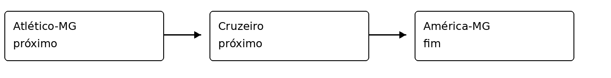

# Listas arrays e repetições

**Unidade curricular:** Algoritmos e Programação  
**Professor:** Alexandre de Oliveira — Montanha

| Integrante | RA |
|---|---|
| Henrique Gabriel Oliveira Santos | 126221443435 |
| Daniel Willer de Souza Lima | 126221446430 |

## 1 Aula e exemplos

### 1 Por que utilizamos laços de repetição

Usamos para repetir uma tarefa sem escrever o mesmo comando várias vezes. Neste trabalho, o laço percorre os times e ajuda a montar os confrontos.

**Momento da aula:** [02:51 a 03:35](https://www.youtube.com/watch?v=JzwH1EVyO1Q&t=171s).

### 2 Qual é a diferença entre while e do-while

O `while` verifica a condição antes de executar. Se ela já for falsa, ele não executa nenhuma vez. O `do-while` verifica depois, então executa pelo menos uma vez.

Um exemplo é pedir uma nota de 0 a 10. Com `do-while`, pedimos a primeira nota e depois verificamos se precisamos pedir de novo. Na aula, o professor mostra que começar com zero pode impedir a entrada no `while`, mas o `do-while` ainda executa uma vez.

**Momento da aula:** [14:08 a 16:00](https://www.youtube.com/watch?v=JzwH1EVyO1Q&t=848s).

### 3 No exemplo dos times em C#, por que são necessários dois laços

Um laço escolhe o time mandante e o outro passa pelos adversários. Assim, cada time pode enfrentar todos os outros. Só um laço não faria todas as combinações.

**Momento da aula:** [31:25 a 32:30](https://www.youtube.com/watch?v=JzwH1EVyO1Q&t=1885s).

### 4 Qual é a função do if que impede confrontos de um time contra ele mesmo

Ele verifica se os índices são diferentes. Se `i` e `j` forem iguais, representam o mesmo time, então o jogo não é mostrado nem contado.

### 5 Duas diferenças de sintaxe e um conceito que permanece igual

Java e C# usam o `for` com inicialização, condição e incremento. Rust usa `for` com `in`. Outra diferença é a impressão: Java usa `System.out.println`, C# usa `Console.WriteLine` e Rust usa `println!`.

A lógica continua sendo repetir uma tarefa e percorrer os elementos de uma coleção.

## 2

### 21

Ficam em posições consecutivas na memória e são acessados pelo índice, começando em zero. No programa, `times[0]` representa o Atlético-MG e `times[1]`, o Cruzeiro. No array de `String` do Java, essas posições guardam referências para os textos.

**Leitura:** páginas 47 e 49 a 51 do PDF.

### 2



**Leitura:** páginas 48 a 50 do PDF.

### 3

No array, inserir ou excluir no meio pode exigir mover os elementos seguintes. Se não houver espaço para adicionar, uma estrutura dinâmica baseada em array pode precisar de outro espaço de memória.

Na lista encadeada, mudamos as ligações entre os nós. Mas precisamos primeiro encontrar o lugar certo. No campeonato, essa diferença aparece quando alteramos a coleção de times.

**Leitura:** páginas 52 a 54 do PDF.

### 4

Não. Segundo a documentação da Microsoft, `List<string>` usa um array interno que pode aumentar. No Rust, `Vec<String>` também é uma estrutura contígua que pode crescer. As duas permitem acessar pelo índice e não são listas encadeadas.

Fontes: https://learn.microsoft.com/en-us/dotnet/api/system.collections.generic.list-1?view=net-10.0

https://doc.rust-lang.org/std/vec/struct.Vec.html

### 5

Podemos acessar os times diretamente pelo índice e percorrer todos usando `for`. Isso facilita combinar o time da posição `i` com o da posição `j`, repetindo o processo para gerar os jogos.

**Leitura:** páginas 50 e 51 do PDF.

## 3 – Atividade pratica

## 4 Alteração da coleção

### 1 Por que o array de Java exigiu a criação de outro array

Porque o tamanho do array é fixo. Criamos um novo com cinco posições, copiamos os quatro nomes usando `for` e colocamos o Tombense na posição 4. Depois, a variável `times` passa a apontar para o novo array.

### 2 O que ficou mais simples com List<string> e Vec<String>

Não precisamos fazer a cópia manual. Em C# usamos `Add` e, em Rust, `push`. A própria estrutura cuida do espaço necessário para guardar o novo elemento.

### 3 A facilidade de adicionar significa que são listas encadeadas

Não. Elas usam arrays internos que podem crescer. O nome da coleção não define se ela é uma lista encadeada. Essa diferença foi confirmada na documentação de `List<T>` e `Vec<T>`.

## 5 Comparação das sintaxes

| Operação | Java | C# | Rust |
|---|---|---|---|
| Criar a coleção | `String[] times = {"Atlético-MG", "Cruzeiro", "América-MG", "Villa Nova"};` | `List<string> times = new List<string> {` | `let mut times: Vec<String> = vec![` |
| Consultar a quantidade | `times.length` | `times.Count` | `times.len()` |
| Acessar pelo índice | `times[i]` | `times[i]` | `times[i]` |
| Percorrer a coleção | `for (int i = 0; i < times.length; i++)` | `for (int i = 0; i < times.Count; i++)` | `for i in 0..times.len()` |
| Dois laços aninhados | `for (int i = 0; i < times.length; i++) { for (int j = 0; j < times.length; j++) {` | `for (int i = 0; i < times.Count; i++) { for (int j = 0; j < times.Count; j++) {` | `for i in 0..times.len() { for j in 0..times.len() {` |
| Impedir o próprio time | `if (i != j)` | `if (i != j)` | `if i != j` |
| Acrescentar o quinto time | `String[] novosTimes = new String[5];` e cópia com `for` | `times.Add("Tombense");` | `times.push(String::from("Tombense"));` |

Os trechos de criação de C# e Rust continuam com os nomes dos times nas linhas seguintes dos códigos. No Java, a cópia e a inclusão do quinto time são feitas assim:

```java
String[] novosTimes = new String[5];
for (int i = 0; i < times.length; i++) {
    novosTimes[i] = times[i];
}
novosTimes[4] = "Tombense";
times = novosTimes;
```

Mudaram a escrita dos comandos, a criação da coleção e a forma de consultar seu tamanho. O raciocínio ficou igual: percorrer os times, combinar os índices, impedir jogos inválidos e contar os confrontos.

## 6 Teste de mesa e validação

Para o teste de mesa, usamos 0 = Atlético-MG, 1 = Cruzeiro e 2 = América-MG.

| Índice do primeiro time | Índice do segundo time | Combinação examinada | Exibe o jogo? Por quê? |
|---|---|---|---|
| 0 | 0 | Atlético-MG x Atlético-MG | Não. Mesmo índice. |
| 0 | 1 | Atlético-MG x Cruzeiro | Sim. Índices diferentes. |
| 0 | 2 | Atlético-MG x América-MG | Sim. Índices diferentes. |
| 1 | 0 | Cruzeiro x Atlético-MG | Sim. Índices diferentes. |
| 1 | 1 | Cruzeiro x Cruzeiro | Não. Mesmo índice. |
| 1 | 2 | Cruzeiro x América-MG | Sim. Índices diferentes. |
| 2 | 0 | América-MG x Atlético-MG | Sim. Índices diferentes. |
| 2 | 1 | América-MG x Cruzeiro | Sim. Índices diferentes. |
| 2 | 2 | América-MG x América-MG | Não. Mesmo índice. |

### Resultados obtidos nas três linguagens

| Quantidade de times | Jogos de ida e volta | Jogos em turno único |
|---|---|---|
| 3 | 6 | 3 |
| 4 | 12 | 6 |
| 5 | 20 | 10 |

### 1 Por que a quantidade de combinações examinadas pode ser maior que a quantidade de jogos exibidos

Porque os laços também chegam às combinações de um time com ele mesmo. Com três times, examinamos nove combinações, mas descartamos três. Por isso, mostramos seis jogos de ida e volta.

### 2 O que acontece com os confrontos quando acrescentamos um time

O novo time enfrenta todos os antigos. Ao passar de quatro para cinco times, acrescentamos oito jogos na ida e volta e quatro no turno único. Os totais passam de 12 para 20 e de 6 para 10.

### 3 As três linguagens produziram os mesmos jogos e totais

Sim. As três versões produziram os mesmos jogos, na mesma ordem, com os totais da tabela. Também conferimos que não houve jogos contra o próprio time nem pares invertidos no turno único.

Para testar três times, usamos cópias temporárias com os três primeiros nomes e apenas uma etapa. Os arquivos entregues continuam começando com quatro e acrescentando o quinto.

### Evidências de execução

As saídas completas estão nestes arquivos:

- [Java](evidencias/java.txt)
- [C#](evidencias/csharp.txt)
- [Rust](evidencias/rust.txt)
- [Comparação dos resultados](evidencias/validacao.md)

Trecho do teste com três times, igual nas três linguagens:

```text
Ida e volta:
Atlético-MG x Cruzeiro
Atlético-MG x América-MG
Cruzeiro x Atlético-MG
Cruzeiro x América-MG
América-MG x Atlético-MG
América-MG x Cruzeiro
Total: 6
Turno único:
Atlético-MG x Cruzeiro
Atlético-MG x América-MG
Cruzeiro x América-MG
Total: 3
```

## 7 Organização e participação da dupla

### Erro encontrado e correção

Durante as tentativas de rodar os códigos, tivemos erros simples, como esquecer um ponto e vírgula. No Java, por exemplo, escrever `int total = 0` sem o `;` causa a mensagem `';' expected`. A correção foi colocar `int total = 0;` e executar de novo.

Esse erro foi reproduzido em uma cópia temporária para registrar a mensagem, sem deixar o problema no código entregue.

### Henrique Gabriel Oliveira Santos

Fiquei responsável pela primeira metade do trabalho, com as respostas iniciais, a leitura sobre arrays e a primeira versão em Java. Fizemos em ligação, então eu consultava o Daniel quando surgiam dúvidas e também ajudava na parte dele. Depois revisamos tudo detalhadamente juntos. Meu principal aprendizado foi entender como os dois laços combinam os times e como os índices evitam jogos repetidos.

### Daniel Willer de Souza Lima

Fiquei responsável pela outra metade, com as versões em C# e Rust, a comparação das sintaxes e a organização dos testes e do relatório. Como fizemos em ligação, fui consultando o Henrique e acompanhando a parte dele também. No final, revisamos o trabalho inteiro juntos. Meu principal aprendizado foi perceber que a escrita muda de uma linguagem para outra, mas a lógica dos laços e dos confrontos continua igual.

### Uso de IA

Utilizamos o ChatGPT para nos auxiliar na criação e revisão dos códigos, principalmente em C# e Rust, porque ainda não vimos essas linguagens direito na faculdade e tivemos mais contato com Java. A ferramenta também ajudou a organizar as respostas e os testes. Depois conferimos os códigos, os resultados e as explicações.

## 8 Referências

- MONTANHA DEV. *Loops em Java, C# e Rust*. Aula online. [YouTube](https://www.youtube.com/watch?v=JzwH1EVyO1Q). Trechos usados: 02:51–03:35, 14:08–16:00, 31:25–32:30 e 34:09–35:12.
- BHARGAVA, Aditya Y. *Entendendo algoritmos: um guia ilustrado para programadores e outros curiosos*. 1. ed. São Paulo: Novatec Editora, 2017. Capítulo 2, páginas 44–54 do PDF consultado. ISBN 978-85-7522-662-9.
- MICROSOFT LEARN. *List<T> Class*. [Documentação oficial](https://learn.microsoft.com/en-us/dotnet/api/system.collections.generic.list-1).
- RUST. *Vec*. [Documentação oficial](https://doc.rust-lang.org/std/vec/struct.Vec.html).
- Material de aula: *Aula 08 — Teoria de Arrays*.
